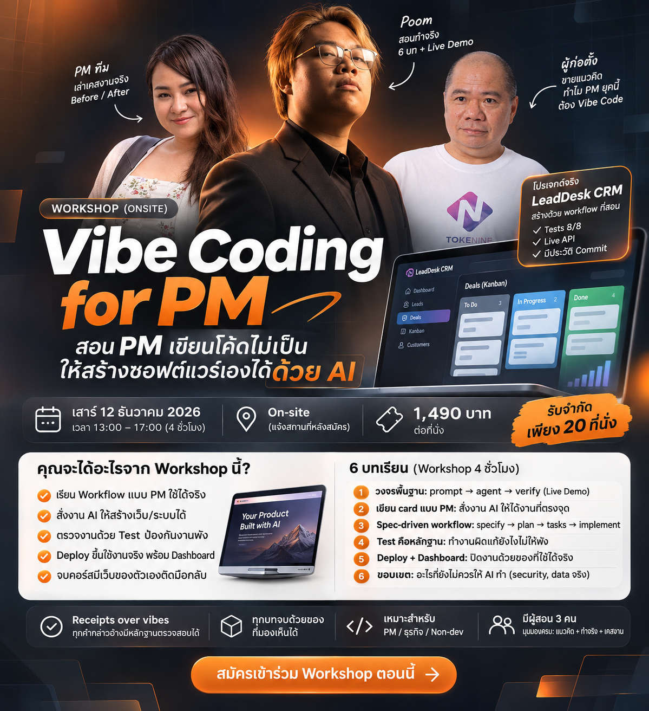

# Vibe Coding for PM — Onsite Workshop

เวิร์กช็อป onsite สอน Vibe Coding สำหรับ PM — สั่ง AI เขียนโค้ดได้จริงใน 3 บทเรียน hands-on: สร้างโปรเจกต์ → เพิ่มฟีเจอร์ → deploy ขึ้นอินเทอร์เน็ตจริง ไม่ต้องมีพื้นฐานเขียนโค้ด

## รายละเอียดงาน

| | |
|---|---|
| วันเวลา | เสาร์ที่ 12 ธันวาคม 2026, 13:00–17:00 (เวลาไทย GMT+7) |
| สถานที่ | Bluebelt Dojo, Bangkok (ประกาศสถานที่เร็ว ๆ นี้) |
| รูปแบบ | Onsite, hands-on 4 ชั่วโมง |
| ที่นั่ง | จำกัดเพียง 15 ที่นั่ง |
| ราคา | 1,490 บาท ต่อคน (ชำระครั้งเดียว) |

## เหมาะกับใคร

- Product Manager และทีม non-dev ที่ไม่ต้องมีพื้นฐานเขียนโค้ด
- คนที่อยากใช้ AI สร้างซอฟต์แวร์ที่ใช้งานได้จริงให้ทีมตัวเอง

## สิ่งที่ได้เรียน (3 บทเรียน hands-on)

1. สร้างโปรเจกต์จริงด้วย AI ตั้งแต่เริ่มต้น
2. เพิ่มฟีเจอร์และปรับแต่งให้ตรงความต้องการ
3. Deploy ขึ้นอินเทอร์เน็ตให้คนอื่นใช้งานได้จริง

## สมัคร / ชำระเงิน

- **ลงทะเบียนและชำระเงิน:** https://whop.com/facebook-com-c5f7/vibe-coding-for-pm-onsite-workshop/
- **RSVP / ดูรายละเอียดงาน:** https://luma.com/j4gab9of

## สำหรับผู้เรียนที่ลงทะเบียนแล้ว

สื่อการสอนทั้งหมด (slide, starter code, แบบฝึกหัด) อยู่ใน **private repository** — ผู้ที่ลงทะเบียนและชำระเงินแล้วจะได้รับสิทธิ์เข้าถึงเป็นการส่วนตัวหลังจบคอร์ส
